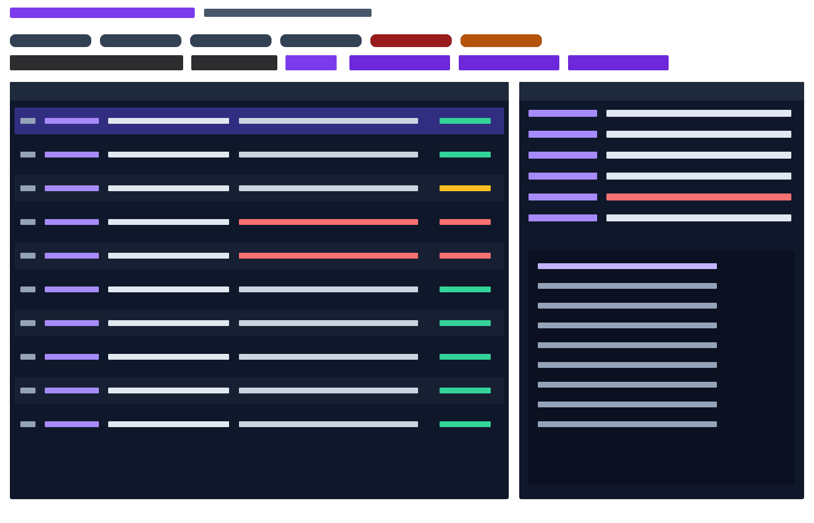

# Terraform HCL & Module Viewer for VS Code

Inspect `*.tf`, `*.tfvars` and `.terraform.lock.hcl` files right in VS Code without running the Terraform CLI or connecting to a cloud account. Production infrastructure folders grow across resources, data sources, remote modules, variables and lock files where an open `0.0.0.0/0` ingress rule, an unencrypted database, a hardcoded password or an unpinned module source is easy to miss. This extension parses HCL2 and variable files locally in plain JavaScript with zero Terraform binary and zero cloud calls.

## What it opens

- `*.tf`, `*.tfvars` and `.terraform.lock.hcl` files.
- Any open Terraform file via the Command Palette or Explorer context menu (Open in Terraform HCL & Module Viewer).
- Nothing to install, no Terraform CLI or cloud credentials required, nothing uploaded.

## The free part

- Resource and block tree: lists every `resource`, `data`, `module`, `variable`, `output`, `locals`, `provider` and `terraform` block with computed dependency tier, reference count and status.
- Provider and module version table: shows every remote module `source` and `version` constraint alongside `required_providers` and `.terraform.lock.hcl` entries.
- Dependency reference inspector: displays every `var.*`, `local.*`, `module.*`, `data.*` and resource reference for the selected block with sensitive values masked.
- Static security findings: flags `0.0.0.0/0` open ingress rules, `encrypted = false` / `storage_encrypted = false` storage, hardcoded AWS keys or passwords, wildcard IAM actions and unpinned remote modules.

## The Pro tools, with 1 free try

Pro adds the audit, diff and export steps: generate a Markdown IaC security and module-pinning audit for one file or a Terraform folder, compare two `.tfvars` or `.tf` files (such as staging vs prod) in Markdown with secrets masked, or export a Mermaid dependency graph, Markdown report and CSV resource inventory locally. Your first try of each Pro tool is free. Zovo Pro is USD 19 once, and the team licence is USD 59.

## Why not plain text

Reading a 500-line Terraform configuration as raw HCL makes it easy to miss that one security group still allows `0.0.0.0/0`, that `storage_encrypted = false` sits inside an RDS block, or that a remote registry module has no version pin. A local viewer puts the resource tree, module versions and security findings on one screen.

## More tools by Zovo

See full docs and install options at [vscode.zovo.one/extensions/zovo-terraform-hcl-viewer/](https://vscode.zovo.one/extensions/zovo-terraform-hcl-viewer/), browse all Zovo VS Code extensions at [vscode.zovo.one](https://vscode.zovo.one/), or explore [Zovo Pro](https://vscode.zovo.one/pro/).
